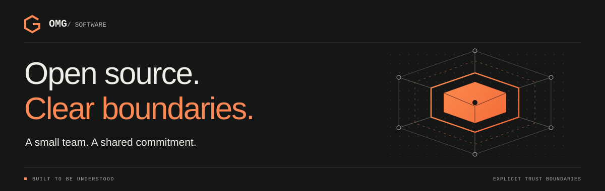

# OMG Software

**A small team. A shared commitment.**

We are Orange Marmalade Gravy Software: a couple of people building open-source software with security at the centre. We care about what our software does, who can inspect it, and where its limits are.

[Meet OMG](https://omg-software.org/) · [Explore our projects](#projects) · [Get involved](#get-involved)

## About us

Software should be open to inspection. Security should be part of the work.

We build tools for communications, infrastructure, community software, and AI evaluation. We ask difficult questions about trust, test how systems fail, and explain what is still unfinished. We want people to understand the software they choose to run.

## Projects

### Merovingian · Matrix homeserver

**A homeserver with boundaries.**

A Matrix homeserver in modern C++26. Built around process isolation, defensive configuration, and documented security boundaries.

**Beta.** For evaluation and testing. Not ready for production use.

[Repository](https://github.com/OMG-Software/Merovingian) · [Documentation](https://omg-software.github.io/Merovingian/)

### Persephone · Matrix desktop client

**A considered approach to the client.**

A Rust and Tauri desktop Matrix client in early development. Designed with explicit trust boundaries, with Merovingian as a primary integration target. The current Windows prototype can sign in and show rooms and message history.

**Early development.** Not ready for real use. Only Windows is currently built and tested. No milestone has passed its acceptance gates, and no production security controls exist yet.

[Repository](https://github.com/OMG-Software/Persephone) · [Project site](https://omg-software.github.io/Persephone/)

### Our wider work

| Project | What we are building | Readiness |
| --- | --- | --- |
| [TheWatcher](https://github.com/OMG-Software/TheWatcher) | Server and endpoint monitoring with user-space agents, metrics collection, runtime configuration, and a web dashboard. | Active development. |
| [Atomiser](https://github.com/OMG-Software/Atomiser) | Invite-only community video hosting with role-based access, passkeys, and queued transcoding. Built with Python and FastAPI. | Working application with setup and deployment documentation. Review current limitations before deploying. |
| [LLM Prompt Injection Testing](https://github.com/OMG-Software/LLM-prompt-injection-testing) | A benchmark and evaluation harness for language models working with mixed-trust documentation. Tests include retrieval errors, artifact laundering, and tool escalation. | Evaluation and research tooling. Results apply to the tested scenarios. |

Project summaries were checked against public READMEs on **25 October 2026**. Follow each repository for current status and limitations.

## Our approach

- **Make boundaries explicit.** Define what is trusted, what is exposed, and what happens when something fails. Document the design decisions.
- **Make behaviour testable.** Prefer reproducible builds, useful tests, and operational visibility. Test realistic failure modes alongside expected behaviour.
- **Say what is unfinished.** State project status and known limits. A prototype, a beta, and a release are different things.

## Get involved

Good software is a shared effort. You do not need to write code to help.

- **Explore.** Start with a project's README, readiness notes, and documentation.
- **Question.** Examine an assumption or report a problem you can reproduce. Check the repository's security guidance before reporting a potential vulnerability.
- **Contribute.** A focused test, a documentation fix, or a small code change is a good place to begin. Read the contribution guidance and open issues first.

Licensing is defined per repository. Check the project's `LICENSE` file before using, redistributing, or contributing code.

[Visit omg-software.org](https://omg-software.org/) · [Browse all repositories](https://github.com/orgs/OMG-Software/repositories)
